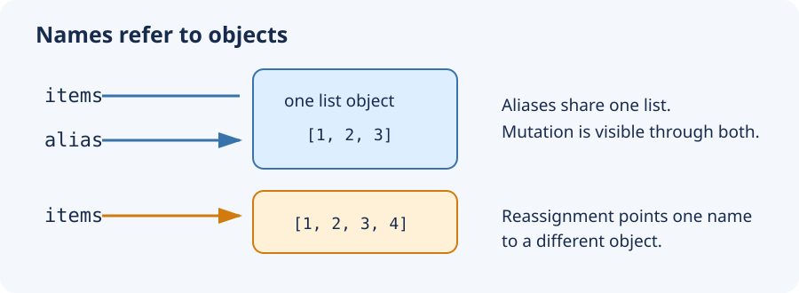

# Names, References, and Objects in Python

## Introduction

Python creates objects and binds names to them. This model explains why two
variables can expose the same list mutation, why assigning a new value to one
name need not affect another, and how functions work with their arguments.

## `id` and `type`

Every object has an identity, a type, and a value. `type(value)` reports the
type; `id(value)` returns an identity integer, unique among simultaneously
living objects. In CPython it commonly represents the memory address, but that
is an implementation detail. `is` compares identity; `==` compares values.

```py
items = [1, 2]
alias = items
print(type(items))             # <class 'list'>
print(id(items) == id(alias))  # True
print(items is alias)          # True
```

Two different lists may compare equal while not being the same object:

```py
left = [1, 2]
right = [1, 2]
print(left == right)           # True
print(left is right)           # False
```

## Mutable objects

A mutable object can change its contents without changing identity. Built-in
mutable types include `list`, `dict`, `set`, and `bytearray`. Assignment binds
a name to an object; it does not copy the object. `items` and `alias` below
are aliases for one list, so a mutation through either name is visible through
both.

```py
items = [1, 2, 3]
alias = items
items.append(4)
print(alias)                   # [1, 2, 3, 4]
```

Rebinding a name differs from mutating an object. `items + [4]` creates another
list; assigning the result changes only which list `items` names.

```py
items = [1, 2, 3]
alias = items
items = items + [4]
print(alias)                   # [1, 2, 3]
print(items)                   # [1, 2, 3, 4]
```

`copy_list` makes a shallow copy: the outer list is new, while nested objects
remain shared.

```py
original = [[1], 2]
copy = original[:]
print(copy == original, copy is original)  # True False
original[0].append(3)
print(copy)                   # [[1, 3], 2]
```

## Immutable objects

An immutable object cannot be changed after creation. Built-in immutable types
include numbers (`int`, `float`, `complex`), `str`, `tuple`, `frozenset`, and
`bytes`. An apparent update produces a value and rebinds a name; it does not
change the old integer or string.

```py
a = 1
b = a
a += 1
print(a, b)                   # 2 1
```

Names can be pictured as arrows to objects. Reassignment moves a name's arrow;
the old object remains while something refers to it.

```text
Before:  a ──┐
             ├──> integer object: 1
         b ──┘

After a = 2:
         a ─────> integer object: 2
         b ─────> integer object: 1
```

Tuples and frozensets are immutable containers, but they may contain mutable
objects. A tuple's element cannot be replaced, but a list held in that element
can be mutated:

```py
box = ([1, 2],)
box[0].append(3)
print(box)                    # ([1, 2, 3],)
# box[0] = [] raises TypeError
```

## Why mutability matters

Aliases to a mutable object all observe in-place changes. Immutable values
cannot be changed in place, so `number += 1` rebinds `number`. This distinction
matters when copying data, sharing state, and passing objects to functions.
`append` mutates a list; `items = items + [4]` creates a new list.

CPython preallocates 262 small integers, typically the range -5 through 256.
Its implementation names the negative and positive bounds
`NSMALLNEGINTS` and `NSMALLPOSINTS`. Reusing these common values avoids
repeated allocations. This is an implementation optimization, not a reason to
use `is` for numbers. String interning and compiler constant folding can also
make identity examples depend on context.

## Function arguments: binding by assignment

When a function is called, its parameter name is bound to the argument object,
often described as passing by assignment. Mutating a mutable argument changes
the shared object; rebinding the parameter changes only the local name. An
operation on an immutable value likewise rebinds only the local parameter.

```py
def add_item(values):
    values.append(4)

def increment(number):
    number += 1

data = [1, 2, 3]
count = 1
add_item(data)
increment(count)
print(data)                   # [1, 2, 3, 4]
print(count)                  # 1
```

Similarly, `parameter = other` inside a function does not overwrite the
caller's variable. Return a replacement object and assign the result at the
call site when the caller should use it.
